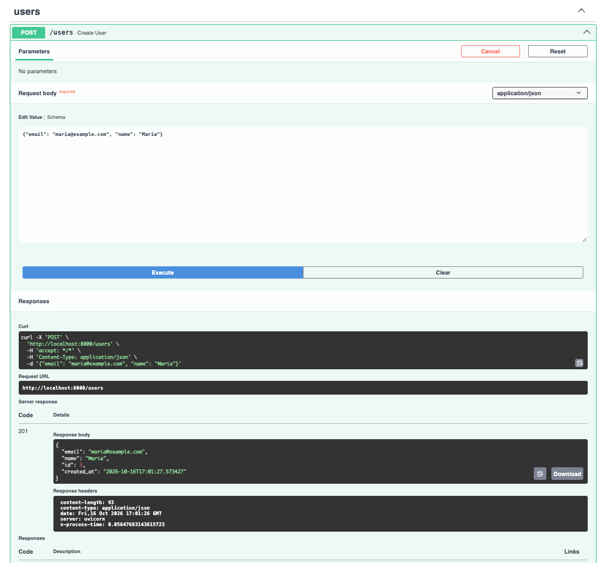
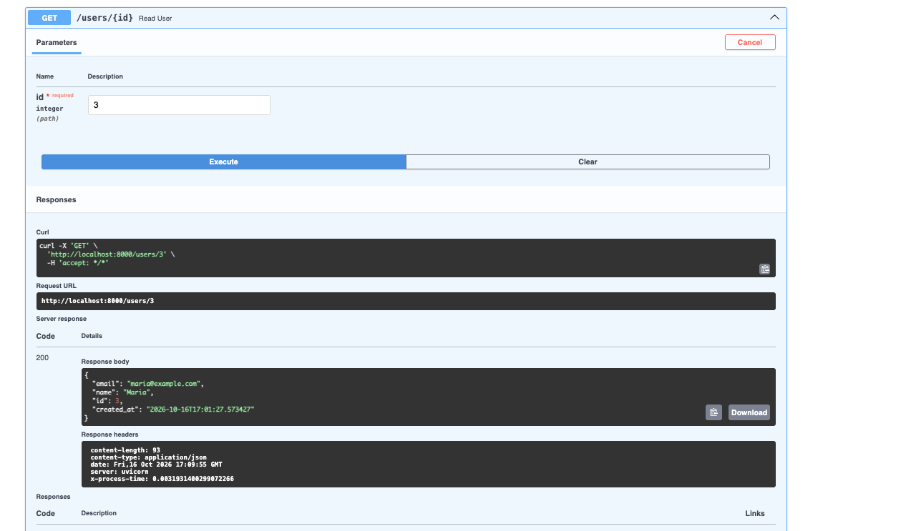
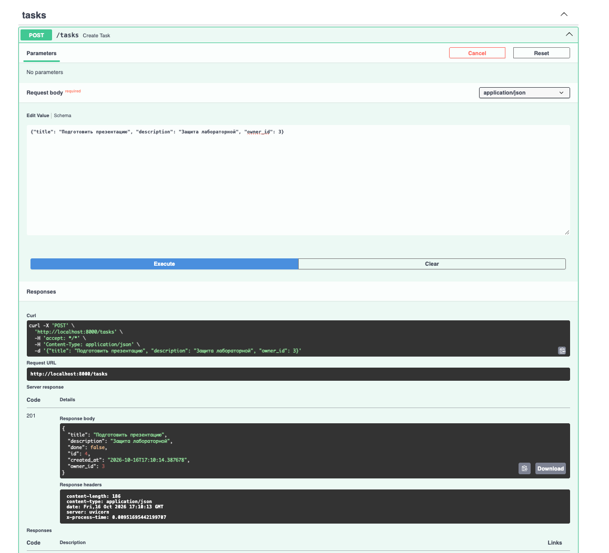
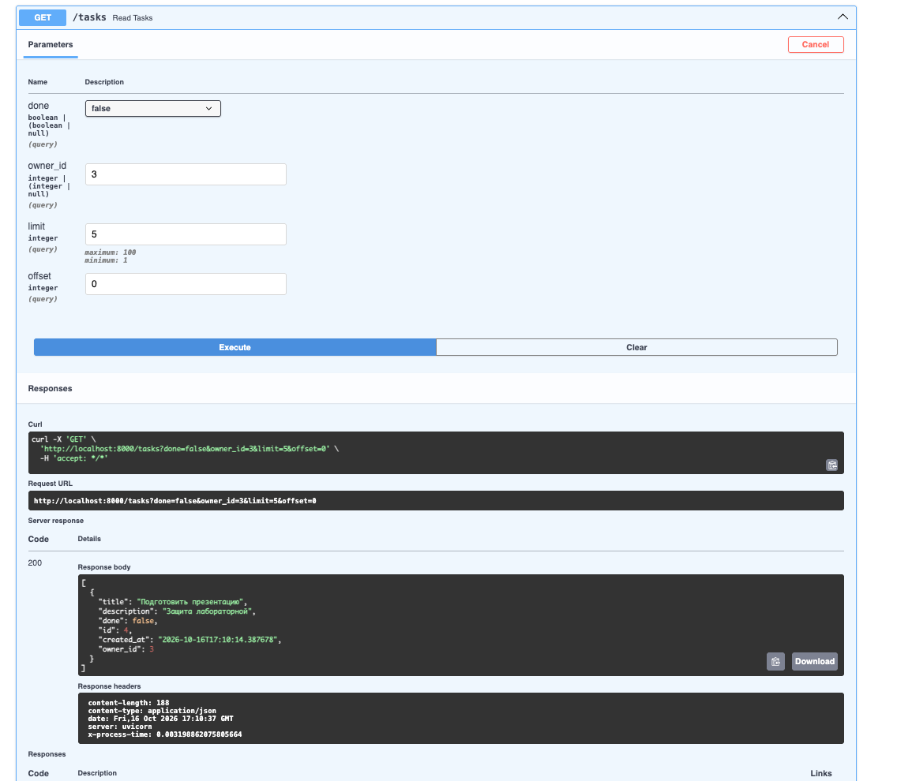
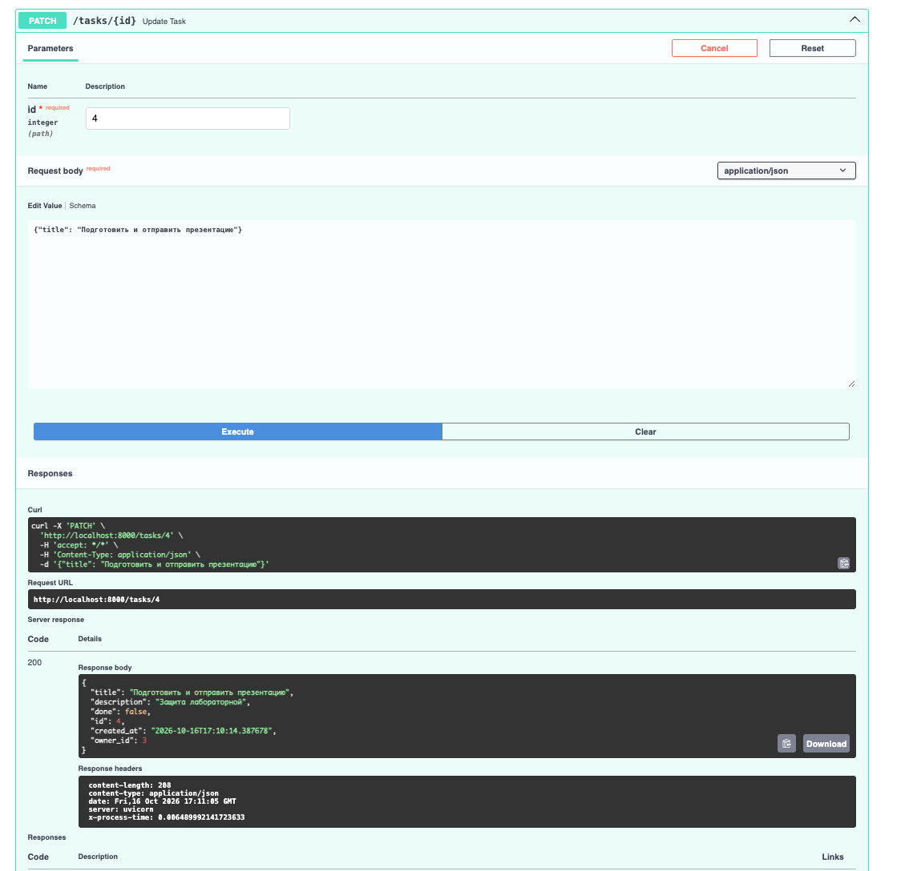
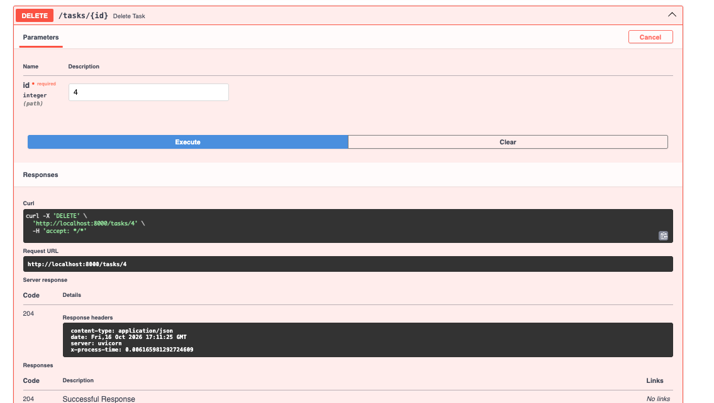
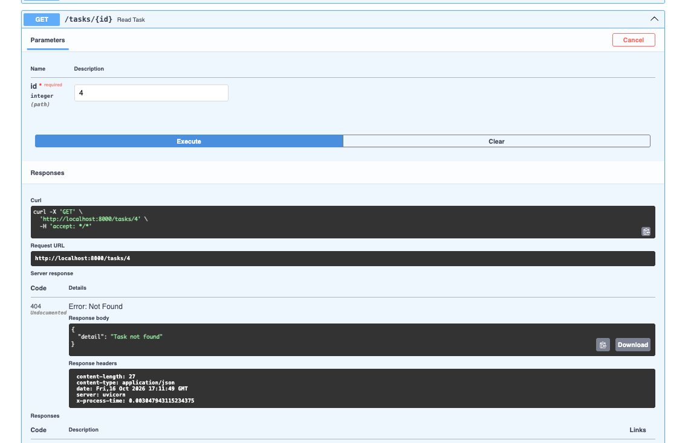
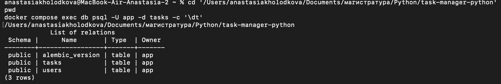
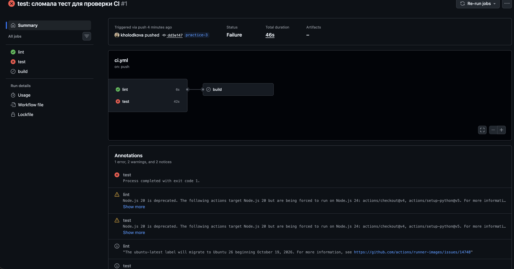
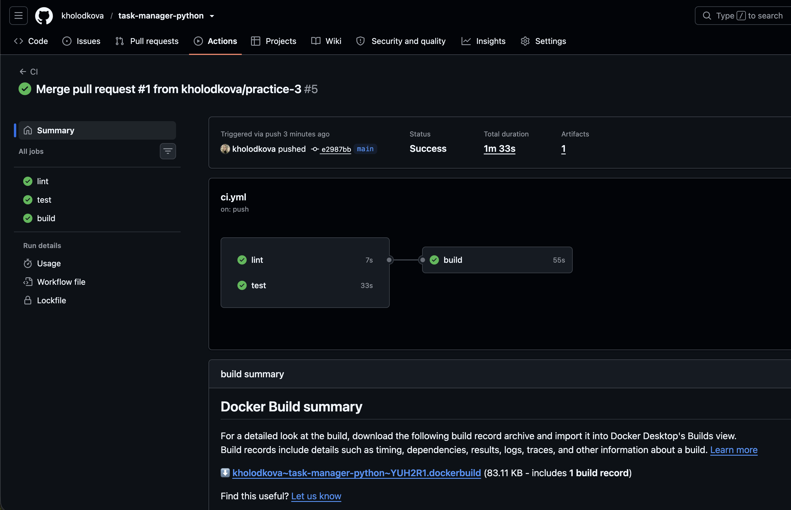

# Менеджер задач — FastAPI + PostgreSQL + SQLAlchemy + Pydantic


Практические работы № 2 и № 3: REST API для хранения пользователей и их задач, автоматические тесты, контейнеризация и CI/CD.

Стек: FastAPI, Starlette (middleware), SQLAlchemy 2.0 (async, asyncpg), Pydantic v2, pydantic-settings, Alembic, PostgreSQL 16 в Docker.

## Требования

- Python 3.11+
- Docker и Docker Compose
- Git

## Запуск

1. Клонировать репозиторий и перейти в папку проекта:

   ```bash
   git clone https://github.com/kholodkova/task-manager-python.git
   cd task-manager-python
   ```

2. Создать файл с переменными окружения из образца:

   ```bash
   cp .env.example .env
   ```

3. Запустить PostgreSQL и проверить доступность:

   ```bash
   docker compose up -d db
   docker compose exec db psql -U app -d tasks -c "select 1"
   ```

4. Создать виртуальное окружение и установить зависимости:

   ```bash
   python3 -m venv .venv
   source .venv/bin/activate
   pip install -r requirements.txt
   ```

5. Применить миграции (таблицы создаются только миграцией Alembic, `create_all` не используется):

   ```bash
   alembic upgrade head
   ```

6. Запустить сервис:

   ```bash
   uvicorn app.main:app --reload
   ```

7. Открыть Swagger UI: http://localhost:8000/docs

Остановка: `Ctrl+C` для сервиса, `docker compose stop` для базы. Данные сохраняются в томе `pgdata`.

## Структура проекта

```
app/
├── __init__.py
├── main.py          # создание приложения, middleware, подключение роутеров
├── config.py        # настройки (pydantic-settings), DATABASE_URL
├── db.py            # асинхронный движок, фабрика сессий, Base, get_session
├── models.py        # ORM-модели User и Task (SQLAlchemy 2.0)
├── schemas.py       # Pydantic-схемы Create / Read / Update
└── routers/
    ├── users.py     # /users
    └── tasks.py     # /tasks
migrations/          # Alembic (async), первая миграция в versions/
.github/workflows/   # GitHub Actions: lint, test и build
docker/              # создание отдельной тестовой БД
tests/               # автоматические тесты API
alembic.ini
Dockerfile           # этапы сборки wheels, test и runtime
docker-compose.yml   # PostgreSQL 16, приложение и тесты
requirements.txt
requirements-dev.txt # зависимости для тестов и линтера
.env.example         # образец DATABASE_URL
```

## Эндпоинты

| Метод | Путь | Описание | Коды ответа |
|---|---|---|---|
| POST | /users | создать пользователя | 201, 409 (email занят), 422 |
| GET | /users/{id} | получить пользователя | 200, 404 |
| POST | /tasks | создать задачу | 201, 404 (нет владельца), 422 |
| GET | /tasks | список задач; фильтры `done`, `owner_id`; пагинация `limit` (1–100), `offset` | 200 |
| GET | /tasks/{id} | получить задачу | 200, 404 |
| PATCH | /tasks/{id} | частично обновить задачу | 200, 404, 422 |
| DELETE | /tasks/{id} | удалить задачу | 204, 404 |

Каждый ответ содержит заголовок `X-Process-Time` — время обработки запроса в секундах; метод, путь, статус и время пишутся в лог сервиса.

## Скриншоты

### Swagger UI

| Запрос | Скриншот |
|---|---|
| POST /users → 201 |  |
| GET /users/{id} → 200 |  |
| POST /tasks → 201 |  |
| GET /tasks → 200 |  |
| PATCH /tasks/{id} → 200 |  |
| DELETE /tasks/{id} → 204 |  |
| GET /tasks/{id} → 404 |  |

### Таблицы в БД (`\dt` в psql)

```bash
docker compose exec db psql -U app -d tasks -c '\dt'
```



## Ответы на контрольные вопросы (практическая № 2)

**1. Чем FastAPI отличается от Starlette и какие компоненты Starlette он использует?**

Я понимаю это так: Starlette даёт базовые вещи для работы веб-приложения, например маршруты, запросы, ответы и middleware. FastAPI построен на основе Starlette и добавляет проверку данных через Pydantic, зависимости через `Depends` и автоматическую документацию Swagger. В этом проекте механизм Starlette используется в middleware, которое добавляет заголовок `X-Process-Time`.

**2. Зачем разделять схемы Create, Read и Update?**

Отдельные схемы нужны, потому что при создании, чтении и изменении нужен разный набор полей. Например, при создании задачи клиент передаёт `title` и `owner_id`, а `id` и `created_at` создаёт само приложение. При обновлении все поля необязательны, потому что можно изменить только одно поле.

**3. Что делает `from_attributes=True`?**

`from_attributes=True` разрешает Pydantic брать данные из атрибутов объекта. Из базы получаем объект SQLAlchemy, например `Task`. С этой настройкой Pydantic может сам прочитать его `id`, `title` и другие поля. Без неё пришлось бы вручную создавать словарь с данными.

**4. Почему сессия передаётся через Depends, а не создаётся глобально?**

Сессию лучше создавать отдельно для каждого запроса. Если сделать одну глобальную сессию, одновременные запросы могут мешать друг другу. Через `Depends(get_session)` каждый обработчик получает свою сессию, а после ответа она закрывается.

**5. Чем `exclude_unset=True` отличается от `exclude_none=True`?**

`exclude_unset=True` убирает поля, которые клиент вообще не передал. `exclude_none=True` убирает все поля со значением `None`, даже если клиент передал их специально. Например, `{"description": null}` с `exclude_unset=True` очистит описание. С `exclude_none=True` такое поле было бы пропущено.

**6. Почему в production таблицы не создают через `create_all`?**

`create_all` умеет создавать отсутствующие таблицы, но не хранит историю изменений. В production база уже содержит данные, поэтому важно изменять её постепенно и понимать, какие изменения уже применены. Для этого нужен Alembic: каждое изменение схемы хранится в отдельной миграции, которую можно применить или откатить.

## Зависимости вне списка из задания

- `sqlalchemy[asyncio]` вместо `sqlalchemy` — ставит пакет greenlet, без которого асинхронный режим SQLAlchemy не импортируется.
- `email-validator` — без него не работает тип `EmailStr`, который требуется в шаге 7.

## Практическая работа № 3

### Запуск тестов локально

Для тестов используется отдельная база `tasks_test`. Сначала нужно запустить PostgreSQL и установить зависимости для разработки:

```bash
docker compose up -d db
python3 -m venv .venv
source .venv/bin/activate
pip install -r requirements-dev.txt
python -m pytest -q
```

Каждый тест начинает работу с чистыми таблицами. Через `app.dependency_overrides` обычная сессия приложения заменяется тестовой сессией.

### Запуск тестов через Docker Compose

```bash
docker compose --profile test run --rm tests
```

Сервис `tests` собирается из этапа `test` Dockerfile и запускается после того, как PostgreSQL пройдёт healthcheck.

### Запуск приложения через Docker Compose

```bash
docker compose up -d --build
```

- `db` — PostgreSQL 16 с healthcheck;
- `app` ждёт готовности БД, выполняет `alembic upgrade head` и запускает Uvicorn;
- Swagger UI открывается по адресу http://localhost:8000/docs.

### Dockerfile

Dockerfile состоит из трёх этапов:

1. `wheels` собирает wheel-файлы зависимостей.
2. `test` создаёт образ для автотестов.
3. `runtime` создаёт финальный образ приложения без dev-зависимостей. Приложение запускается от непривилегированного пользователя `appuser` с UID 10001.

### CI/CD

Workflow `.github/workflows/ci.yml` выполняет следующие задачи:

| Job | Когда запускается | Что делает |
|---|---|---|
| `lint` | каждый push и pull request | проверяет проект командой `ruff check` |
| `test` | каждый push и pull request | запускает pytest с PostgreSQL |
| `build` | push в `main` после успешных `lint` и `test` | собирает и публикует образ в GHCR и Docker Hub |

Для публикации в Docker Hub используются GitHub Actions secrets `DOCKERHUB_USERNAME` и `DOCKERHUB_TOKEN`.

### Скриншоты CI

Pull request с намеренно сломанным тестом:



Успешный pipeline после исправления теста:



### Опубликованный образ

- GHCR: https://github.com/kholodkova/task-manager-python/pkgs/container/task-manager-python
- Docker Hub: https://hub.docker.com/r/kholodkova/task-manager-python

```bash
docker pull ghcr.io/kholodkova/task-manager-python:latest
docker pull kholodkova/task-manager-python:latest
```

## Ответы на контрольные вопросы (практическая № 3)

**1. Чем CI отличается от CD (continuous delivery и continuous deployment)?**

CI проверяет код после изменений. Например, GitHub Actions запускает линтер и тесты. Если есть ошибка, я увижу её до добавления кода в ветку `main`.

CD отвечает за доставку готовой версии. При continuous delivery программа готова к публикации, но её запускает человек. При continuous deployment успешная версия публикуется автоматически.

**2. Как работает `dependency_overrides` и зачем он нужен в тестах?**

`app.dependency_overrides` позволяет временно заменить зависимость FastAPI. В моих тестах обычная функция `get_session` заменяется на тестовую. Поэтому запросы работают с базой `tasks_test`, а рабочая база `tasks` не изменяется.

**3. Зачем нужна многоэтапная сборка образа?**

Сборка разделена на несколько этапов. На одном этапе подготавливаются зависимости, на другом запускаются тесты, а на последнем создаётся образ приложения. В финальный образ не попадают тесты и лишние инструменты, поэтому он получается меньше.

**4. Почему контейнер не следует запускать от root?**

Пользователь root имеет слишком много прав. Если в приложении будет ошибка, через неё можно будет изменить больше файлов и настроек контейнера. Обычный пользователь `appuser` имеет меньше прав, поэтому такой запуск безопаснее.

**5. Как в GitHub Actions передаются секреты и почему их нельзя хранить в репозитории?**

Секреты добавляются в настройках GitHub-репозитория. В workflow к ним обращаются через запись `${{ secrets.ИМЯ }}`. Сам токен нельзя писать в коде или загружать в Git: тогда его смогут увидеть другие люди и использовать от моего имени.

**6. Что произойдёт с job `build`, если упадёт `test`? Где это задаётся?**

Если тесты упадут, job `build` не запустится и Docker-образ не будет опубликован. Это задаёт строка `needs: [lint, test]` в файле `ci.yml`. Условие `if` дополнительно разрешает сборку только после push в ветку `main`.

**7. Где лучше применять миграции: при старте контейнера или отдельным шагом в CD? Каковы плюсы и минусы каждого варианта?**

При старте контейнера миграции применяются автоматически. Из минусов - при запуске нескольких контейнеров они могут одновременно начать одну миграцию. Если миграция завершится с ошибкой, приложение не запустится.

Отдельный шаг CD запускает миграцию один раз перед новой версией приложения. Если появится ошибка - публикацию можно остановить.
